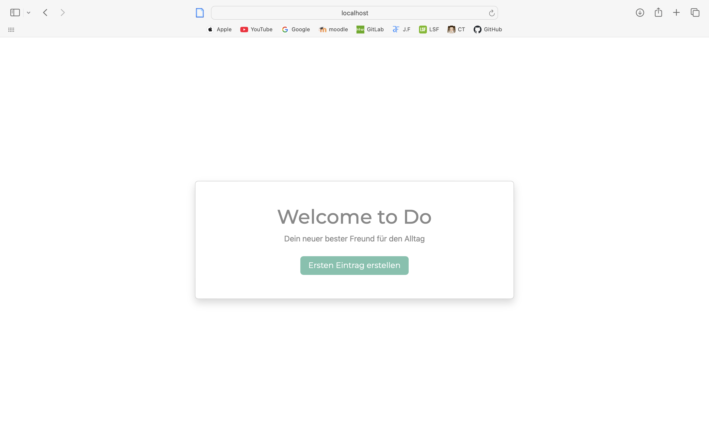
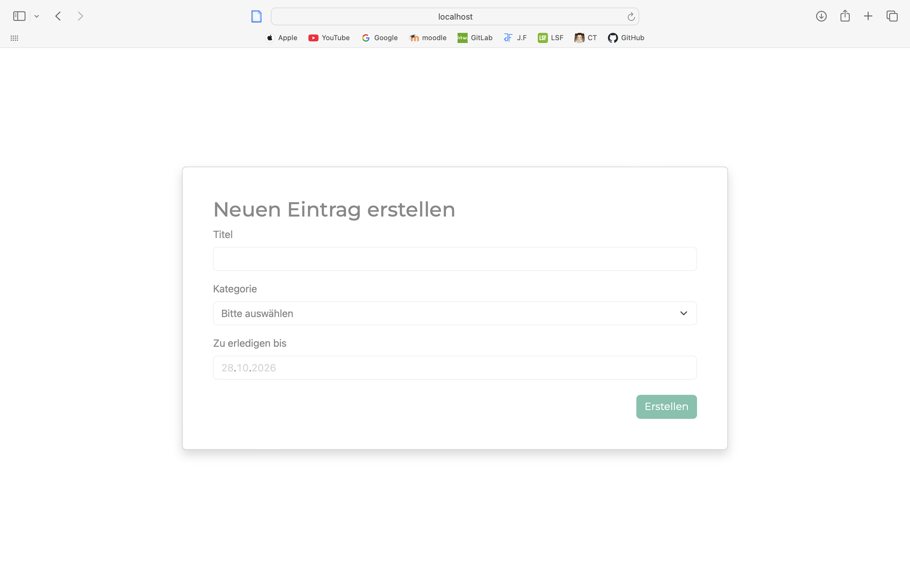
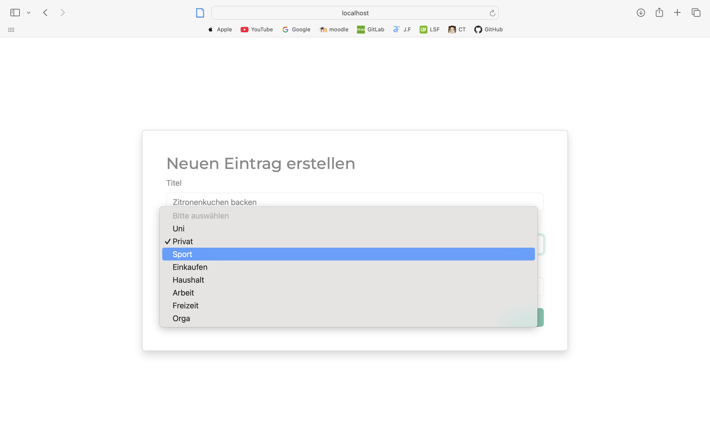
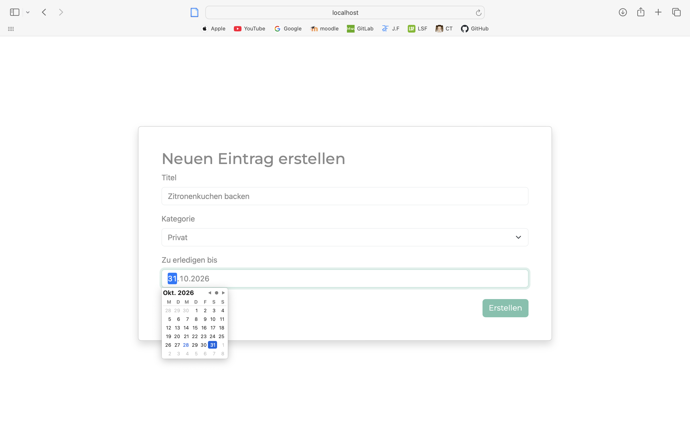
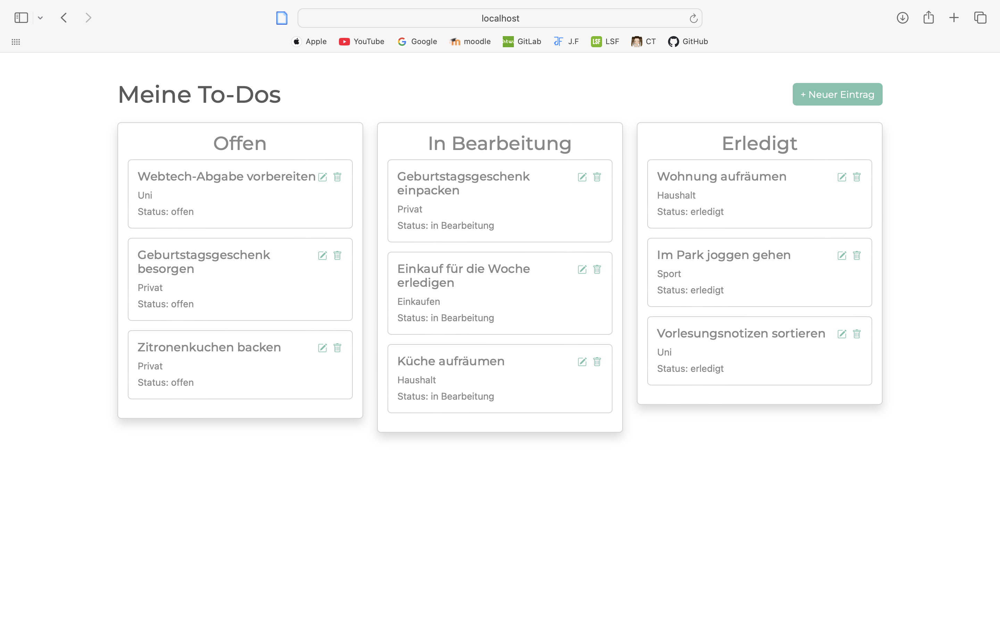
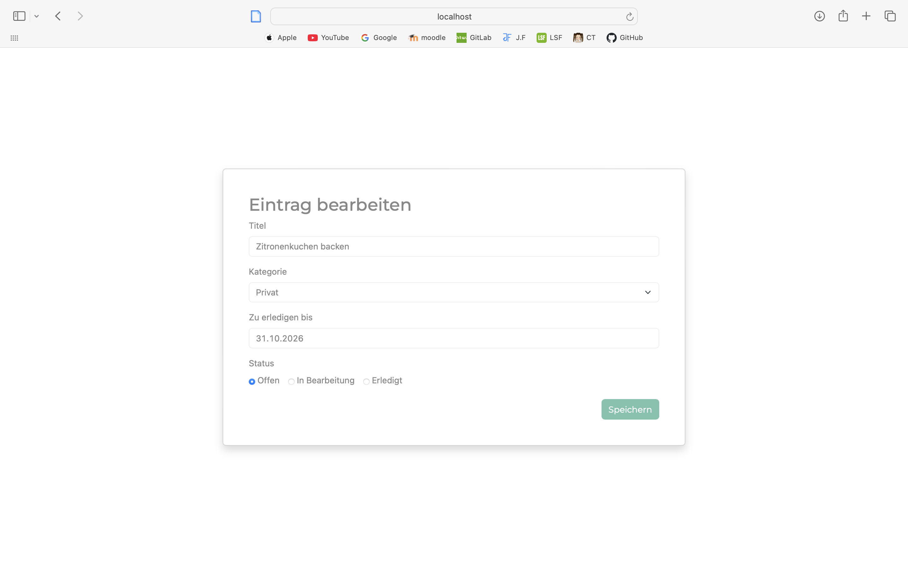
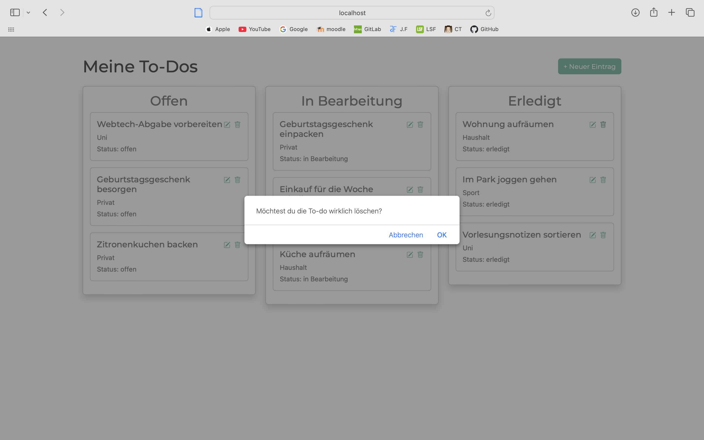

# ToDo - Dein neuer bester Freund für den Alltag

## Inhaltsverzeichnis

- [Projektbeschreibung](#projektbeschreibung)
- [Funktionen](#funktionen)
- [Technologien](#technologien)
- [Screenshots](#screenshots)
- [Installation](#installation)
- [API-Endpunkte](#api-endpunkte)
- [KI-Verzeichnis](#ki-verzeichnis)
- [Autoren](#autoren)


## Projektbeschreibung

Die To-do-Anwendung hilft dabei, persönliche Aufgaben übersichtlich zu organisieren. Einträge werden in einer Datenbank gespeichert und können erstellt, angezeigt, bearbeitet und gelöscht werden. In der Übersicht sind die To-dos nach ihrem Status in die Spalten „Offen“, „In Bearbeitung“ und „Erledigt“ eingeteilt.

## Funktionen

Die ToDo App bietet folgende Funktionen:

- **To-do erstellen:** 
  - Ein neuer Eintrag wird mit Titel, Kategorie und optionalem Fälligkeitsdatum angelegt. Der Status ist zunächst „offen“.

- **To-dos anzeigen:** 
  - Alle gespeicherten Einträge werden in einer Übersicht nach ihrem Status sortiert.

- **To-do bearbeiten:** 
  - Über das Stift-Symbol auf einer Karte öffnet sich die Bearbeitungsansicht. Titel, Kategorie, Fälligkeitsdatum und Status können geändert und gespeichert werden.

- **Status ändern:** 
  - Der Status wird in der Bearbeitungsansicht ausgewählt. Die Änderung wird erst übernommen, wenn auf „Speichern“ geklickt wird.

- **To-do löschen:** 
  - Über das Mülleimer-Symbol kann ein Eintrag gelöscht werden. Vor dem Löschen erscheint eine Bestätigungsabfrage.
- **Responsives Design:** 
  - Bootstrap passt die Darstellung an verschiedene Bildschirmgrößen an.


## Technologien

Für die Entwicklung der ToDo App wurden folgende Technologien eingesetzt:

| Technologie                 | Verwendung                                              |
|-----------------------------|---------------------------------------------------------|
| **Angular**                 | Entwicklung des Frontends und der Benutzeroberfläche    |
| **Bootstrap (Bootswatch minty)** | Responsives Design und Gestaltung der Benutzeroberfläche |
| **Node.js**                 | Umsetzung des Backends und der REST-API                     |
| **MongoDB und Mongoose**        | Speicherung und Verwaltung der To-dos                                   |
| **TypeScript**                | Programmiersprache für das Angular-Frontend                               |
| **Git & GitHub**            | Versionsverwaltung                                      |
| **Postman**                 | Testen der API-Endpunkte                                |


## Screenshots
### Startseite
Nach dem Start der Anwendung gelangt der Benutzer zunächst auf die Willkommensseite. Über den Button **„Ersten Eintrag erstellen“** kann direkt eine neue Todo angelegt werden.

<p align="center">
  
</p>

---
### Neuen Eintrag erstellen

Im Formular werden Titel, Kategorie und optional ein Fälligkeitsdatum eingegeben.

<p align="center">
  
</p>

---

Die Kategorien werden vom Backend geladen und im Auswahlmenü angezeigt.

<p align="center">
  
</p>

---

Für das Fälligkeitsdatum steht ein integrierter Kalender zur Verfügung.

<p align="center">
  
</p>

---
### To-do-Übersicht

Die Einträge werden nach ihrem Status in die Spalten „Offen“, „In Bearbeitung“ und „Erledigt“ eingeteilt. Über die Symbole auf einer Karte kann ein Eintrag bearbeitet oder gelöscht werden.

<p align="center">
  
</p>

---
### Todo bearbeiten

In der Bearbeitungsansicht können Titel, Kategorie, Fälligkeitsdatum und Status geändert werden. Die Änderungen werden über den Speichern-Button übernommen.

<p align="center">
  
</p>

Nach dem Speichern werden die Änderungen direkt übernommen und in der Todo Übersicht angezeigt.

--- 
### To-do löschen

Vor dem Löschen erscheint eine Bestätigungsabfrage.

<p align="center">
  
</p>


## Installation

### Voraussetzungen

Für die Anwendung werden benötigt:

- [Node.js und npm](https://nodejs.org/ )
- Eine MongoDB-Datenbank
- Git

### Repositories klonen

Klone beide Repositories

```bash
git clone https://github.com/EylemKmrc/todo-frontend.git
git clone https://github.com/EylemKmrc/todo-backend.git
```

### MongoDB-Verbindung konfigurieren

Lege im Ordner `todo-backend` eine Datei mit dem Namen `.env` an. Trage dort deine MongoDB-Verbindungsdaten und den Datenbanknamen ein:

```dotenv
DB_CONNECTION=mongodb+srv://<BENUTZERNAME>:<PASSWORT>@<CLUSTER-URL>/DATABASE=todoDatabase
```

Ersetze die Platzhalter durch deine eigenen Werte. Die Datei `.env` enthält vertrauliche Zugangsdaten und darf nicht auf git zb. veröffentlicht oder gepusht werden.

### Backend starten

Öffne ein Terminal und führe folgende Befehle aus:

```bash
cd todo-backend
npm install
node src/server.js
```

Das Backend läuft anschließend unter `http://localhost:3000`.

### Frontend starten

Öffne ein zweites Terminal und führe folgende Befehle aus:

```bash
cd todo-frontend
npm install
npm start
```

Das Frontend ist anschließend unter `http://localhost:4200` erreichbar. Öffne diese Adresse im Browser.


## API-Endpunkte

Die Kommunikation zwischen Frontend und Backend erfolgt über eine REST-API.

| Methode | Endpunkt | Beschreibung                                  |
|----------|----------|-----------------------------------------------|
| **GET** | `/todos` | Ruft alle vorhandenen Todos ab.               |
| **GET** | `/todos/:id` | Ruft eine bestimmte Todo anhand seiner ID ab. |
| **POST** | `/todos` | Erstellt eine neue Todo.                      |
| **PATCH** | `/todos/:id` | Aktualisiert die Daten einer vorhandenen Todo. |
| **DELETE** | `/todos/:id` | Löscht eine Todo anhand seiner ID.            |
| **GET** | `/categories` | Gibt alle verfügbaren Kategorien zurück.      |


## KI-Verzeichnis

Bei der Entwicklung des Projekts wurden KI-Werkzeuge verwendet. Die Anwendung wurde schrittweise selbst umgesetzt. Die KI-Unterstützung diente vor allem dazu, den Code gut zu verstehen und Fehler zu beheben.

KI wurde für folgende Aufgaben genutzt:

- Unterstützung bei der Recherche von Bootstrap-Komponenten, Bootstrap-Icons und CSS-Klassen
- Vorschläge zu Bootstrap-Klassen und zur Gestaltung der Benutzeroberfläche
- Hilfe bei der Fehlersuche und beim Verständnis von Fehlermeldungen
- Unterstützung beim Formulieren und Überarbeiten der README
- Erstellung von Beispieldaten für Tests 


## Autoren
Dieses Projekt wurde im Rahmen des Moduls **WebTech** an der **HTW Berlin** entwickelt.

**Autorin:**

Eylem Kömürcü
